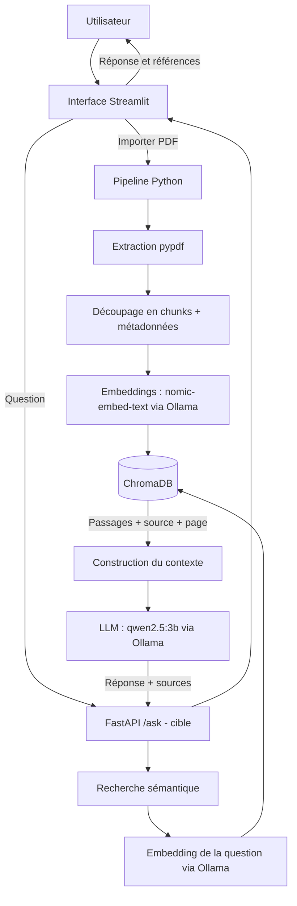
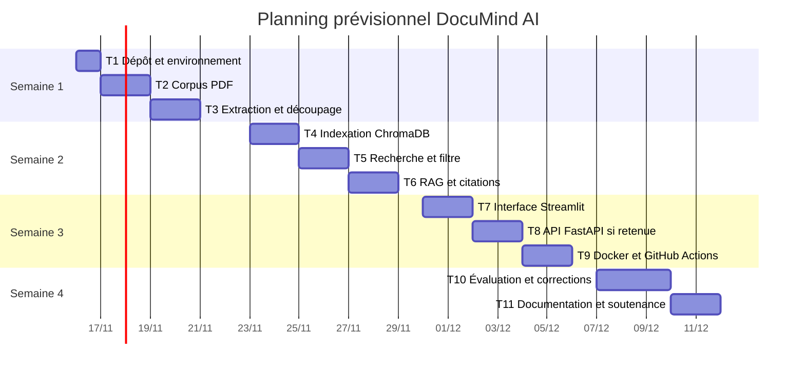

from pathlib import Path

content = r"""# Dossier de lancement — DocuMind AI
**Semaine 1 · 9 novembre 2026**  
**Projet :** DocuMind AI — Assistant intelligent de recherche documentaire basé sur le RAG  
**Équipe :** [Noms des membres à compléter] · **Encadrant :** [Nom à compléter]

> Version préremplie à partir des informations connues sur DocuMind AI. Les éléments inconnus (noms, taille de l'équipe, volume réel du corpus et licences de documents externes) restent signalés comme éléments à confirmer. Les technologies indiquées comme « prévues » ne doivent pas être présentées comme déjà réalisées.

---

## Répartition de l'équipe

| Livrable | Rédacteur | Relecteur | Fichier |
|---|---|---|---|
| 1. Descriptif | [Membre A] | [Membre B] | `docs/semaine1/1-descriptif.md` |
| 2. Dataset | [Membre B] | [Membre C] | `docs/semaine1/2-dataset.md` + `data/sample/` |
| 3. Maquette | [Membre C] | [Membre A] | `docs/semaine1/3-maquette.md` + `docs/semaine1/img/` |
| 4. Pipeline | [Membre D / coordinateur] | [Membre A] | `docs/semaine1/4-pipeline.md` |

Adapter cette répartition à la taille réelle de l'équipe. Le rédacteur et le relecteur d'un même livrable doivent être deux personnes différentes. Chaque membre ajoute lui-même ses tâches au pipeline.

# Livrable 1 — Descriptif du projet

**Rédacteur :** [Nom] · **Relecteur :** [Nom]

## 1.1 Contexte et problème

Les étudiants, enseignants, chercheurs et professionnels consultent régulièrement des documents PDF pour retrouver des informations précises. La recherche manuelle, document par document, est lente et oblige à parcourir de nombreuses pages. Une recherche par mots-clés ne comprend pas toujours le sens de la question et peut manquer des passages pertinents. Il est donc utile de disposer d'un assistant local permettant d'interroger plusieurs documents en langage naturel et de retrouver les passages qui justifient la réponse.

## 1.2 Objectif

Développer un assistant documentaire local capable d'importer des PDF, d'en extraire et indexer le contenu, puis de répondre aux questions en langage naturel à partir des passages pertinents, en indiquant les documents et les pages sources.

## 1.3 Utilisateurs cibles et scénario principal

**Utilisateurs :** étudiants, enseignants, chercheurs et professionnels qui doivent consulter plusieurs documents PDF.

**Scénario :**
1. L'utilisateur ouvre DocuMind AI dans son navigateur.
2. Il importe un ou plusieurs fichiers PDF.
3. Le système extrait le texte page par page, le découpe en segments (*chunks*) et calcule leurs embeddings localement.
4. Les segments et leurs métadonnées (fichier, page, index du segment) sont stockés dans ChromaDB.
5. L'utilisateur pose une question et peut limiter la recherche à un document.
6. Le système récupère les passages pertinents et les transmet au LLM local.
7. L'application affiche la réponse et les références aux documents et pages utilisés.

## 1.4 Fonctionnalités du MVP

| N° | Fonctionnalité | Résultat visible pour l'utilisateur | Priorité |
|---|---|---|---|
| F1 | Importation et ingestion de PDF | Confirmation de l'importation et de l'indexation du document. | Indispensable |
| F2 | Recherche sémantique | Passages les plus pertinents retrouvés à partir d'une question en langage naturel. | Indispensable |
| F3 | Réponse RAG avec citations | Réponse fondée sur les passages récupérés, avec nom du fichier et numéro de page. | Indispensable |
| F4 | Filtrage par document et historique de session | Choix d'un document ou de tous les documents ; consultation des échanges de la session. | Souhaitable |

## 1.5 Services et composants techniques

| Composant | Rôle | Technologie | Justification |
|---|---|---|---|
| LLM | Générer une réponse à partir du contexte récupéré. | Ollama + `qwen2.5:3b` | Exécution locale, sans coût d'API par question. |
| Embeddings | Vectoriser les documents et les questions. | Ollama + `nomic-embed-text` | Calcul local des embeddings, cohérent avec l'objectif sans API payante. |
| Recherche / mémoire | Stocker les segments et effectuer la recherche vectorielle. | ChromaDB | Base vectorielle persistante et intégration simple en Python. |
| Extraction PDF | Extraire le texte et les numéros de page. | Python + pypdf | Bibliothèque légère adaptée aux PDF textuels. |
| Orchestration RAG | Coordonner ingestion, recherche, contexte et génération. | Python (`src/`) | Séparation claire des responsabilités du projet. |
| API | Exposer le service de question-réponse. | FastAPI **[prévu / à confirmer]** | API Python légère avec documentation automatique. |
| Interface | Importer les documents et interroger l'assistant. | Streamlit | Développement rapide d'une interface de démonstration. |
| Conteneurisation et CI | Reproduire l'environnement et automatiser les vérifications. | Docker, GitHub Actions **[à mettre en place]** | Faciliter le lancement et vérifier le code à chaque modification. |

**État technique connu :** l'application Streamlit appelle actuellement les modules Python ; l'ingestion et la recherche utilisent ChromaDB et Ollama localement. FastAPI, Docker et GitHub Actions sont à traiter comme des objectifs tant qu'ils ne sont pas effectivement intégrés et testés.

## 1.6 Hors périmètre

- OCR des PDF entièrement scannés.
- Analyse avancée des images, graphiques, tableaux complexes et documents manuscrits.
- Authentification, gestion multi-utilisateur et permissions documentaires avancées.
- Déploiement cloud ou accès public.
- API LLM ou embeddings payants.
- Indexation de très grands volumes de documents.
- Garantie d'absence d'erreur : l'assistant doit pouvoir signaler qu'une réponse n'est pas présente dans le corpus.

## 1.7 Écart avec la fiche du catalogue

Le projet est concrétisé sous la forme d'une application locale appelée **DocuMind AI**. Ollama exécute le LLM et le modèle d'embeddings localement ; ChromaDB assure le stockage vectoriel ; Streamlit fournit l'interface. FastAPI, Docker et GitHub Actions sont conservés comme objectifs techniques à réaliser ou à confirmer dans le cadre du projet.

**Critères d'acceptation :**
- [x] Problème et utilisateurs explicités.
- [x] Fonctionnalités démontrables et priorisées.
- [x] Composants techniques et justifications renseignés.
- [x] Hors périmètre défini.
- [ ] Taille de l'équipe et nombre de fonctionnalités confirmés avec l'enseignant.

# Livrable 2 — Dataset

**Rédacteur :** [Nom] · **Relecteur :** [Nom]

## 2.1 Description

Le jeu de données de DocuMind AI est constitué de fichiers PDF importés par l'utilisateur. Pour la démonstration et le dépôt Git, l'équipe utilisera un petit corpus d'exemple non sensible. Les CV réels et autres documents contenant des données personnelles ne doivent pas être publiés dans le dépôt.

| Rubrique | Réponse |
|---|---|
| Nom et source | Corpus PDF de démonstration DocuMind AI, constitué de documents synthétiques et/ou de documents publics dont la licence aura été vérifiée. |
| Producteur / propriétaire | Équipe projet pour les documents synthétiques ; éditeurs d'origine pour les documents publics. |
| Volume | Cible : 5 à 10 PDF, moins de 10 Mo au total. **Volume réel à mesurer après création de `data/sample/`.** |
| Format et structure | PDF textuels. Extraction page par page ; chaque chunk conserve le texte, le nom du fichier, le numéro de page et son index. |
| Langues / période | Français et anglais ; période non applicable aux documents synthétiques. À préciser pour les documents publics choisis. |
| Licence et droits | Documents synthétiques : créés par l'équipe. Documents publics : licence et conditions de réutilisation à vérifier fichier par fichier. |
| Données personnelles | Aucun renseignement personnel dans le corpus de démonstration prévu. Les CV personnels restent hors du dépôt et ne sont utilisés qu'avec l'accord de leurs propriétaires. |
| Emplacement | Échantillon dans `data/sample/` ; documents privés conservés localement et non versionnés. |

**Action avant remise :** ajouter réellement les PDF dans `data/sample/`, vérifier leur ouverture et renseigner le volume mesuré, les noms, les langues et les licences. Ne pas remplacer une mesure réelle par le volume cible.

## 2.2 Qualité constatée sur l'échantillon

Après constitution du corpus, l'équipe vérifiera : ouverture des PDF, extraction du texte, pages vides, caractères spéciaux et accents, doublons, lisibilité et présence éventuelle de données personnelles. Les PDF scannés sans couche texte seront exclus du MVP. **Les résultats de ce contrôle sont à compléter après inspection réelle des fichiers.**

## 2.3 Justification

| Fonctionnalité | Données utilisées | Pourquoi elles suffisent |
|---|---|---|
| F1 — Ingestion | PDF textuels du corpus. | Vérifier l'ouverture, l'extraction page par page, le découpage et les métadonnées. |
| F2 — Recherche | Chunks et embeddings locaux. | Vérifier que les questions retrouvent les passages attendus. |
| F3 — Réponses et citations | Passages récupérés avec source et page. | Fournir au LLM un contexte vérifiable et afficher les références. |
| F4 — Filtrage et historique | Métadonnées `source` et historique de session. | Limiter les résultats à un fichier et conserver les échanges de la session. |

## 2.4 Alternative de repli

Si les documents publics deviennent inaccessibles ou si leur licence est incertaine, l'équipe utilisera des PDF synthétiques rédigés pour le projet : fiches de cours fictives, notices techniques, descriptions de produits imaginaires et rapports de démonstration.

**Avantage :** disponibilité immédiate, contenu maîtrisé et absence de données personnelles réelles.  
**Limite :** ces documents représentent moins bien la diversité et la difficulté des documents professionnels réels ; ils valident le fonctionnement technique, pas toutes les performances en situation réelle.

## 2.5 Jeu de test et mesure de la qualité

L'équipe préparera **au moins 20 questions** : questions factuelles, questions nécessitant plusieurs passages, questions limitées à un document, questions dont la réponse se trouve dans un autre document et questions sans réponse dans le corpus.

Pour chaque test : identifiant, question, document attendu, page ou passage attendu, éléments attendus dans la réponse et résultat obtenu.

- **Origine :** questions rédigées par l'équipe à partir du corpus.
- **Références attendues :** définies par un membre et vérifiées par un autre.
- **Indicateurs :**
  1. *Recall@k* : présence du passage attendu parmi les k passages récupérés.
  2. Exactitude : proportion des éléments attendus correctement restitués.
  3. Fidélité : absence d'affirmations non soutenues par les documents.
  4. Qualité des citations : exactitude du fichier et du numéro de page.
  5. Temps de réponse : durée entre l'envoi de la question et l'affichage de la réponse.

Les seuils chiffrés seront fixés après une première mesure sur le jeu de test, et non inventés à l'avance.

**Critères d'acceptation :**
- [ ] PDF d'exemple présents dans `data/sample/` et ouvrables.
- [ ] Licences des documents publics vérifiées.
- [ ] Aucun document personnel non autorisé versionné.
- [ ] Chaque fonctionnalité du MVP couverte par le corpus.
- [ ] Alternative de repli disponible.
- [ ] Jeu d'au moins 20 questions avec réponses et passages attendus préparé.

# Livrable 3 — Maquette globale

**Rédacteur :** [Nom] · **Relecteur :** [Nom]

## 3.1 Schéma d'architecture cible

Le schéma suivant présente l'architecture cible. L'implémentation actuellement connue utilise Streamlit et les modules Python directement. Si FastAPI n'est pas intégré au MVP, le schéma final devra représenter cet appel direct au lieu de montrer une API non réalisée.

## 3.2 Légende

| Composant | Rôle | Fonction |
|---|---|---|
| Streamlit | Import, sélection de documents, questions et affichage. | F1 à F4 |
| Pipeline Python / pypdf | Extraction du texte page par page. | F1 |
| Découpage en chunks | Préparer des passages adaptés à la recherche. | F1, F2 |
| Ollama + nomic-embed-text | Vectoriser les passages et les questions. | F1, F2 |
| ChromaDB | Stocker les vecteurs, textes et métadonnées ; rechercher les passages. | F1, F2 |
| FastAPI `/ask` (cible) | Exposer le service de question-réponse si retenu. | F2, F3 |
| Construction du contexte | Préparer les passages récupérés pour le LLM. | F3 |
| Ollama + qwen2.5:3b | Générer la réponse à partir du contexte. | F3 |
| Filtre et historique Streamlit | Choisir un document et consulter les échanges de session. | F4 |

## 3.3 Maquette des écrans

Les captures ou maquettes doivent être ajoutées à `docs/semaine1/img/`. Les noms ci-dessous sont des fichiers à produire, pas des captures déjà disponibles.

| Écran | Image à déposer | Fonctionnalités | Action utilisateur |
|---|---|---|---|
| Accueil et importation | `img/ecran-1-import.png` | Titre, zone d'import PDF, état d'indexation. | Importer un ou plusieurs PDF. |
| Recherche documentaire | `img/ecran-2-chat.png` | Zone de question, historique, filtre document/tous les documents. | Poser une question. |
| Réponse et sources | `img/ecran-3-reponse.png` | Réponse, nom du document, numéros de page et passages sources. | Vérifier les sources et poursuivre la conversation. |

## 3.4 Parcours utilisateur

1. L'utilisateur ouvre l'application et importe ses PDF.
2. Le système extrait le texte, crée les chunks et les indexe dans ChromaDB.
3. L'utilisateur choisit un document ou « Tous les documents » et saisit une question.
4. La question est vectorisée ; les passages pertinents sont récupérés et envoyés au LLM local.
5. La réponse s'affiche avec les références documentaires et les pages.
6. L'utilisateur peut poser une autre question ; l'historique de la session reste visible.

**Critères d'acceptation :**
- [x] Le schéma décrit l'ingestion et le parcours d'une question jusqu'à la réponse.
- [ ] Le schéma final correspond exactement à l'architecture réellement implémentée.
- [ ] Les captures/maquettes sont déposées dans `docs/semaine1/img/`.
- [ ] Chaque fonctionnalité du MVP apparaît sur au moins un écran.

# Livrable 4 — Pipeline des tâches

**Consolidateur :** [Nom du coordinateur] · **Relecteur :** [Nom]

**Hypothèse de calendrier :** démarrage le 16 novembre 2026, à confirmer avec l'enseignant. Chaque tâche est estimée à un ou deux jours maximum.

## 4.1 Liste des tâches

| ID | Tâche | Fonction | Responsable | Dépend de | Semaine | Critère vérifiable de fin |
|---|---|---|---|---|---|---|
| T1 | Finaliser dépôt, environnement Python et README | Transverse | [Membre A] | — | 1 | Un membre peut cloner, installer et lancer le projet en suivant le README. |
| T2 | Constituer et contrôler le corpus PDF | F1 | [Membre B] | T1 | 1 | Au moins 5 PDF non sensibles sont présents dans `data/sample/`, ouvrables et décrits. |
| T3 | Vérifier extraction, découpage et métadonnées | F1 | [Membre A] | T2 | 1 | Les tests vérifient texte, page, source et découpage sur les PDF d'exemple. |
| T4 | Stabiliser l'indexation dans ChromaDB | F1, F2 | [Membre B] | T3 | 2 | Les vecteurs et métadonnées sont persistés ; réindexer un document ne crée pas de doublons. |
| T5 | Tester la recherche sémantique et le filtre par document | F2, F4 | [Membre C] | T4 | 2 | Les questions de test retrouvent les passages attendus et le filtre isole le document choisi. |
| T6 | Stabiliser génération RAG et citations | F3 | [Membre C] | T5 | 2 | Réponses fondées sur le contexte, avec fichier/page ; absence de réponse signalée si nécessaire. |
| T7 | Finaliser l'interface Streamlit | F1 à F4 | [Membre A] | T4, T6 | 3 | Import, sélection, question et réponse sourcée fonctionnent de bout en bout. |
| T8 | Ajouter/finaliser FastAPI si exigée | F2, F3 | [Membre D] | T6 | 3 | `/ask` reçoit une question et retourne réponse et sources ; tests API réussis. |
| T9 | Préparer Docker et GitHub Actions | Transverse | [Membre D] | T7, T8 | 3 | Image construite et tests automatisés réussis dans GitHub Actions. |
| T10 | Évaluer sur 20 questions et corriger | F1 à F4 | Tous | T7, T8, T9 | 4 | Résultats et indicateurs des 20 tests consignés. |
| T11 | Finaliser documentation et démonstration | Transverse | Tous | T10 | 4 | README, architecture, limites, résultats et scénario de démonstration à jour. |

Les responsables sont proposés et doivent être confirmés par l'équipe. Pour une équipe de moins de quatre membres, redistribuer T8 et T9. Si FastAPI n'est pas exigée, supprimer T8 et adapter T9. Chaque membre doit saisir lui-même ses tâches dans GitHub Issues ou GitHub Projects.

## 4.2 Jalons hebdomadaires

| Semaine | Jalon démontrable | Tâches |
|---|---|---|
| 1 — 16 au 22 novembre | Dossier validé, corpus disponible, prototype d'ingestion et de recherche exécuté en script. | T1, T2, T3 |
| 2 — 23 au 29 novembre | Indexation persistante, recherche sémantique et premier flux de réponse RAG testés. | T4, T5, T6 |
| 3 — 30 novembre au 6 décembre | MVP de bout en bout, interface finalisée, API si retenue, Docker et CI fonctionnels. | T7, T8, T9 |
| 4 — 7 au 13 décembre | Évaluation, corrections, documentation et soutenance. | T10, T11 |

## 4.3 Diagramme de Gantt

## 4.4 Chemin critique et charge

**Chemin critique prévisionnel :** T1 → T2 → T3 → T4 → T5 → T6 → T7 → T10 → T11. Si FastAPI est obligatoire, T8 et T9 deviennent également des dépendances du jalon MVP.

**Charge par membre :** à calculer après confirmation des responsables et de la taille de l'équipe. Le coordinateur doit rééquilibrer les tâches pour que l'écart de charge entre membres reste inférieur à deux jours.

**Critères d'acceptation :**
- [ ] Aucune tâche ne dépasse deux jours.
- [ ] Chaque fonctionnalité a au moins une tâche ; chaque tâche possède un critère vérifiable.
- [ ] MVP démontrable au plus tard à la fin de la semaine 3.
- [ ] Chaque membre a ajouté ses propres tâches.
- [ ] Écart de charge inférieur à deux jours.
- [ ] Issues GitHub ou éléments GitHub Projects créés.

---

# Remise et décision de l'enseignant

## Checklist du coordinateur

- [ ] `docs/semaine1/README.md` contient la répartition réelle des rédacteurs et relecteurs.
- [ ] Les quatre livrables sont présents et fusionnés sur la branche principale après approbation.
- [ ] Un échantillon PDF non sensible est présent dans `data/sample/`.
- [ ] Licences et données personnelles vérifiées.
- [ ] Schéma Mermaid affiché correctement sur GitHub.
- [ ] Maquettes/captures présentes dans `docs/semaine1/img/`.
- [ ] Issues GitHub créées pour les tâches.
- [ ] Étiquette `semaine1-remis` posée sur le dernier commit.
- [ ] Enseignant informé de la remise.

## Décision de l'enseignant

| Critère | Type | Respecté | Commentaire |
|---|---|---|---|
| Données accessibles et échantillon présent (L2) | Bloquant | ☐ | |
| MVP réaliste en quatre semaines (L1, L4) | Bloquant | ☐ | |
| Rédacteur et relecteur distincts pour chaque livrable | Bloquant | ☐ | |
| Licence et données personnelles traitées (L2) | Bloquant | ☐ | |
| Architecture cohérente avec les fonctionnalités (L1, L3) | À améliorer | ☐ | |
| Écrans couvrant le MVP (L3) | À améliorer | ☐ | |
| Tâches courtes, critères vérifiables et charge équilibrée (L4) | À améliorer | ☐ | |
| Alternative de repli et jeu de test définis (L2) | À améliorer | ☐ | |

**Décision :** ☐ Validé  ☐ À reprendre  ☐ Refusé (changement de sujet)  
**Date et visa :** ______________________________________

**Lien avec l'évaluation :** ce dossier sert de référence au critère P1 (respect du cadrage) et alimente P3 (jeu de test et indicateurs) et P7 (pipeline et suivi). La répartition des contributions et les pull requests constituent des preuves de travail individuel.

---

## À confirmer avant l'envoi

1. Remplacer les membres A/B/C/D par les noms réels et adapter la répartition à la taille de l'équipe.
2. Confirmer que chaque rédacteur et relecteur est une personne différente.
3. Ajouter les PDF d'exemple dans `data/sample/`, mesurer le volume et vérifier les licences. Ne pas déposer les CV personnels.
4. Confirmer si FastAPI est obligatoire. Le code connu utilise actuellement Streamlit et les modules Python directement.
5. Ne présenter Docker et GitHub Actions comme réalisés qu'après leur mise en place et leurs tests.
6. Confirmer les dates du 16 novembre au 13 décembre 2026 avec l'enseignant.
7. Créer les captures/maquettes et les déposer dans `docs/semaine1/img/`.
"""
path = Path("/mnt/data/DocuMind_AI_Dossier_Lancement_Semaine1.md")
path.write_text(content, encoding="utf-8")
print(f"Document prêt : {path.name} ({len(content.splitlines())} lignes)")
