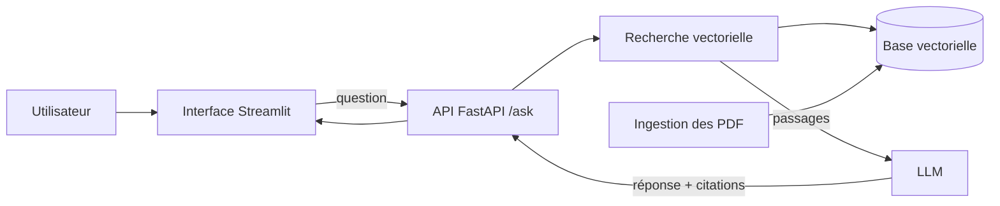
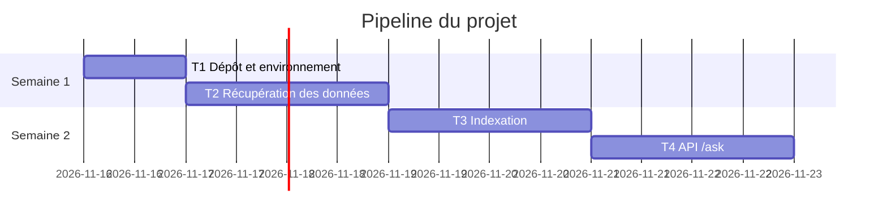

# Dossier de lancement (semaine 1)

Nov 9, 2026 · @Larhlimi

## Mode d'emploi

La semaine 1 est décisive : sur un projet de 4 semaines, un cadrage flou ou des données indisponibles ne se rattrapent pas. Ce dossier permet à l'enseignant de valider, faire reprendre ou refuser le projet sous 48 heures.

Le dossier comporte quatre livrables. **L'équipe se les répartit : chaque membre rédige seul le ou les livrables dont il est responsable, puis un autre membre le relit.** Le nom du rédacteur et du relecteur figure en tête de chaque livrable ; c'est une preuve de contribution pour la note individuelle.

**Répartition selon la taille de l'équipe**

| Taille | Membre A | Membre B | Membre C | Membre D |
| --- | --- | --- | --- | --- |
| 2 étudiants | 1. Descriptif + 3. Maquette | 2. Dataset + 4. Pipeline |  |  |
| 3 étudiants | 1. Descriptif + 4. Pipeline (consolidation) | 2. Dataset | 3. Maquette |  |
| 4 étudiants | 1. Descriptif | 2. Dataset | 3. Maquette | 4. Pipeline (consolidation) |

Le pipeline des tâches (livrable 4) est consolidé par un seul membre, mais **chaque membre y ajoute lui-même ses propres tâches**.

**Notre répartition**

| Livrable | Rédacteur | Relecteur | Fichier dans le dépôt |
| --- | --- | --- | --- |
| 1. Descriptif du projet | \[à compléter\] | \[à compléter\] | `docs/semaine1/1-descriptif.md` |
| 2. Dataset | \[à compléter\] | \[à compléter\] | `docs/semaine1/2-dataset.md` + `data/sample/` |
| 3. Maquette globale | \[à compléter\] | \[à compléter\] | `docs/semaine1/3-maquette.md` + `docs/semaine1/img/` |
| 4. Pipeline des tâches | \[à compléter\] | \[à compléter\] | `docs/semaine1/4-pipeline.md` |

**Circuit GitHub**

1. Le coordinateur crée le dossier `docs/semaine1/` avec un `README.md` qui reprend le tableau « Notre répartition ».
2. Chaque rédacteur copie la section de son livrable dans le fichier indiqué, travaille sur sa propre branche (`semaine1/dataset`, par exemple) et ouvre une pull request.
3. Le relecteur vérifie les critères d'acceptation du livrable, commente dans la pull request, puis l'approuve.
4. Une pull request n'est fusionnée qu'après approbation. Les quatre livrables sont fusionnés sur la branche principale avant la date limite.
5. Le coordinateur pose l'étiquette `semaine1-remis` sur le dernier commit et en informe l'enseignant.

Remplacez chaque `[à compléter]` par vos réponses. Les exemples en italique viennent du projet n° 1 du catalogue (agent de recherche documentaire) ; supprimez-les dans votre version. Le dossier rempli tient sur 4 à 6 pages, maquettes comprises.

## Livrable 1 : descriptif du projet mis à jour

Rédacteur : \[à compléter\]   Relecteur : \[à compléter\]   Fichier : `docs/semaine1/1-descriptif.md`

Le descriptif adapte la fiche du catalogue à votre version du projet. Il doit pouvoir être lu seul par quelqu'un qui ne connaît pas le catalogue.

**1.1 Contexte et problème** (5 lignes au plus) : quel problème métier, pour qui, comment on fait aujourd'hui sans l'agent. \[à compléter\]

**1.2 Objectif** en une phrase : \[à compléter\]

**1.3 Utilisateurs cibles et scénario d'usage principal** : qui utilise l'agent et ce qu'il fait, étape par étape. \[à compléter\]

**1.4 Fonctionnalités du MVP** (2 à 3 pour un binôme, 3 à 4 pour un trinôme, 4 à 5 pour une équipe de 4)

| N° | Fonctionnalité | Ce que l'utilisateur voit ou obtient | Priorité (indispensable, souhaitable) |
| --- | --- | --- | --- |
| F1 | \[à compléter\] | \[à compléter\] |  |
| F2 | \[à compléter\] | \[à compléter\] |  |
| F3 |  |  |  |
| F4 |  |  |  |
| F5 |  |  |  |

**1.5 Services et composants techniques**

| Service ou composant | Rôle dans le projet | Technologie choisie | Pourquoi ce choix |
| --- | --- | --- | --- |
| Modèle (LLM ou ML) |  |  |  |
| Recherche ou mémoire (RAG, base vectorielle, SGBD) |  |  |  |
| Outils appelés par l'agent |  |  |  |
| API |  | FastAPI |  |
| Interface |  |  |  |
| Conteneur et intégration continue |  | Docker, GitHub Actions |  |

**1.6 Hors périmètre** (ce que vous ne ferez pas) : \[à compléter\]

**1.7 Écart avec la fiche du catalogue** : ce que vous ajoutez, retirez ou modifiez, et pourquoi. \[à compléter ou « aucun »\]

*Exemple : les ingénieurs d'un bureau d'études cherchent à la main dans 40 normes internes en PDF. Objectif : obtenir en moins de 10 secondes une réponse citée. F1 ingestion et recherche, F2 réponse avec citations, F3 interface Streamlit. Hors périmètre : documents scannés, gestion des droits.*

**Critères d'acceptation (vérifiés par le relecteur)**

- [ ] Le problème et l'utilisateur sont compréhensibles sans le catalogue.
- [ ] Le nombre de fonctionnalités correspond à la taille de l'équipe.
- [ ] Chaque fonctionnalité est démontrable (pas de formulation vague comme « améliorer »).
- [ ] Chaque composant technique a une justification d'une ligne.
- [ ] Le hors périmètre est rempli.

## Livrable 2 : dataset

Rédacteur : \[à compléter\]   Relecteur : \[à compléter\]   Fichiers : `docs/semaine1/2-dataset.md` + `data/sample/`

Sans données utilisables dès la semaine 1, le projet ne peut pas tenir en 4 semaines. **Un échantillon réel doit déjà être dans le dépôt** (quelques fichiers ou une centaine de lignes, moins de 10 Mo). Les données complètes volumineuses ne vont pas dans Git : indiquez où elles se trouvent.

**2.1 Description**

| Rubrique | Réponse |
| --- | --- |
| Nom et source (lien) | \[à compléter\] |
| Producteur ou propriétaire | \[à compléter\] |
| Volume (nombre de fichiers, lignes, pages, taille) | \[à compléter\] |
| Format et structure (PDF, CSV, JSON, logs, images ; colonnes principales) | \[à compléter\] |
| Langue et période couverte | \[à compléter\] |
| Licence et droits d'usage | \[à compléter\] |
| Données personnelles ou sensibles, et traitement prévu | \[à compléter ou « aucune »\] |
| Emplacement des données complètes | \[à compléter\] |

**2.2 Qualité constatée sur l'échantillon** : valeurs manquantes, doublons, bruit, documents illisibles, déséquilibre. \[à compléter\]

**2.3 Justification** : pour chaque fonctionnalité du livrable 1, expliquez en une ligne en quoi ces données permettent de la réaliser.

| Fonctionnalité | Données utilisées | En quoi elles suffisent |
| --- | --- | --- |
| F1 |  |  |
| F2 |  |  |
| F3 |  |  |

**2.4 Alternative de repli** : si la source principale devient inaccessible ou se révèle inutilisable, quelle autre source (jeu public, données simulées ou générées) et ce que vous perdez en l'utilisant. \[à compléter\]

**2.5 Jeu de test** : comment vous mesurerez la qualité de l'agent. Taille (au moins 20 cas), origine, réponses attendues rédigées par qui. \[à compléter\]

*Exemple : 40 articles scientifiques en accès libre (licence CC BY), environ 600 pages PDF, en français et en anglais, aucune donnée personnelle ; 5 PDF dans `data/sample/`. Repli : résumés arXiv en anglais seulement. Jeu de test : 20 questions avec réponses et passages attendus, rédigées par l'équipe.*

**Critères d'acceptation (vérifiés par le relecteur)**

- [ ] L'échantillon est dans `data/sample/` et s'ouvre sans erreur.
- [ ] La licence autorise l'usage dans un projet de cours.
- [ ] Les données personnelles éventuelles sont anonymisées ou remplacées par des données fictives.
- [ ] Chaque fonctionnalité du MVP est couverte par la justification.
- [ ] L'alternative de repli est réellement accessible (lien vérifié).
- [ ] Le jeu de test est défini, même partiellement rédigé.

## Livrable 3 : maquette globale

Rédacteur : \[à compléter\]   Relecteur : \[à compléter\]   Fichiers : `docs/semaine1/3-maquette.md` + `docs/semaine1/img/`

La maquette comporte deux vues : l'architecture (comment le système fonctionne) et les écrans (ce que voit l'utilisateur).

**3.1 Schéma d'architecture.** Montrez les composants du livrable 1, les flux de données et le parcours d'une requête de l'utilisateur jusqu'à la réponse. Pour une équipe de 4, montrez aussi les agents ou sous-systèmes et leurs échanges. Écrivez-le en Mermaid dans le fichier Markdown (GitHub l'affiche directement) ou déposez une image dans `img/`.

Modèle à adapter (exemple du projet n° 1) :

**3.2 Légende du schéma** : une ligne par composant, avec la fonctionnalité (F1, F2...) qu'il sert. \[à compléter\]

**3.3 Maquette des écrans.** 2 à 4 écrans principaux, dessinés à la main et photographiés, ou faits avec l'outil de votre choix. Pour chaque écran :

| Écran | Image (`img/...`) | Fonctionnalités affichées | Action principale de l'utilisateur |
| --- | --- | --- | --- |
| \[à compléter\] |  |  |  |
| \[à compléter\] |  |  |  |
|  |  |  |  |

**3.4 Parcours utilisateur** : enchaînement des écrans pour le scénario principal du livrable 1 (écran A, action, écran B...). \[à compléter\]

**Critères d'acceptation (vérifiés par le relecteur)**

- [ ] Chaque composant du livrable 1 apparaît dans le schéma, et inversement.
- [ ] Le parcours d'une requête se suit de bout en bout sur le schéma.
- [ ] Chaque fonctionnalité du MVP est visible sur au moins un écran.
- [ ] Le schéma s'affiche correctement sur GitHub (Mermaid valide ou image présente).
- [ ] Pour une équipe de 4 : les agents ou sous-systèmes et leurs échanges sont représentés.

## Livrable 4 : pipeline des tâches prévues

Consolidateur : \[à compléter\]   Relecteur : \[à compléter\]   Fichier : `docs/semaine1/4-pipeline.md`

Le pipeline découpe le projet en tâches de 1 à 2 jours. **Chaque membre saisit lui-même ses tâches** ; le consolidateur vérifie les dépendances et l'équilibre de la charge. Les tâches sont aussi créées comme issues GitHub (ou dans un tableau GitHub Projects) pour être suivies dans le rapport hebdomadaire.

**4.1 Liste des tâches**

| ID | Tâche | Fonctionnalité | Responsable | Dépend de | Semaine | Terminée quand ? (critère vérifiable) |
| --- | --- | --- | --- | --- | --- | --- |
| T1 | \[à compléter\] |  |  |  | 1 |  |
| T2 |  |  |  |  |  |  |
| T3 |  |  |  |  |  |  |
| T4 |  |  |  |  |  |  |
| T5 |  |  |  |  |  |  |
| T6 |  |  |  |  |  |  |
| T7 |  |  |  |  |  |  |
| T8 |  |  |  |  |  |  |

*Exemple : T3, « Indexer les 40 PDF dans la base vectorielle », F1, membre B, dépend de T1, semaine 2, terminée quand une requête de test renvoie les 5 passages les plus proches en moins de 2 s.*

**4.2 Jalons hebdomadaires** (repris de la fiche de cadrage)

| Semaine | Jalon démontrable | Tâches qui y mènent |
| --- | --- | --- |
| 1 | Dossier de lancement fusionné, prototype en script |  |
| 2 | Agent exposé par l'API, premiers tests |  |
| 3 | MVP complet, Docker et CI au vert |  |
| 4 | Résultats mesurés, code gelé, soutenance |  |

**4.3 Vue chronologique.** Ajoutez un diagramme de Gantt en Mermaid (modèle ci-dessous, à adapter à vos dates et tâches) :

**4.4 Chemin critique et charge**

- Chaîne de tâches dont le moindre retard décale la soutenance : \[à compléter, par exemple T1, T2, T3, T4\]
- Charge par membre (nombre de jours de tâches) : \[à compléter\]

**Critères d'acceptation (vérifiés par le relecteur)**

- [ ] Aucune tâche ne dépasse 2 jours.
- [ ] Chaque fonctionnalité du MVP a au moins une tâche, et chaque tâche a un critère de fin vérifiable.
- [ ] Le MVP est complet au plus tard en fin de semaine 3.
- [ ] Chaque membre a saisi ses propres tâches ; l'écart de charge entre membres reste inférieur à 2 jours.
- [ ] Les tâches existent comme issues GitHub.

## Remise et décision de l'enseignant

**Checklist de remise (coordinateur)**

- [ ] `docs/semaine1/README.md` avec la répartition rédacteurs et relecteurs
- [ ] Les quatre livrables fusionnés sur la branche principale, chacun par une pull request approuvée par son relecteur
- [ ] Échantillon de données dans `data/sample/`
- [ ] Schéma et écrans visibles sur GitHub
- [ ] Issues GitHub créées pour les tâches du pipeline
- [ ] Étiquette `semaine1-remis` posée et enseignant prévenu

**Décision de l'enseignant (sous 48 heures)**

Un seul critère bloquant suffit pour que le dossier soit à reprendre ; un dossier à reprendre est corrigé et remis sous 48 heures.

| Critère | Type | Respecté | Commentaire |
| --- | --- | --- | --- |
| Données accessibles et échantillon présent (L2) | Bloquant | ☐ |  |
| MVP réaliste en 4 semaines pour cette taille d'équipe (L1, L4) | Bloquant | ☐ |  |
| Livrables répartis, chacun avec un rédacteur et un relecteur distincts | Bloquant | ☐ |  |
| Licence et données personnelles traitées (L2) | Bloquant | ☐ |  |
| Architecture cohérente avec les fonctionnalités (L1, L3) | À améliorer | ☐ |  |
| Écrans couvrant tout le MVP (L3) | À améliorer | ☐ |  |
| Tâches courtes, critères de fin vérifiables, charge équilibrée (L4) | À améliorer | ☐ |  |
| Alternative de repli et jeu de test définis (L2) | À améliorer | ☐ |  |

**Décision** : ☐ Validé   ☐ À reprendre   ☐ Refusé (changement de sujet)

Date et visa : \_\_\_\_\_\_\_\_\_\_\_\_\_\_\_\_\_\_\_\_

**Lien avec l'évaluation.** Ce dossier sert de référence pour le critère P1 (respect du cadrage) et alimente P3 (jeu de test et indicateurs) et P7 (pipeline et suivi). La répartition et les pull requests de chaque membre comptent comme preuves pour le coefficient individuel.
