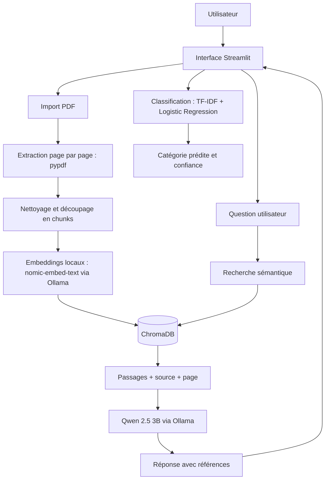

# Fiche de suivi, semaine 1 : cadrage et lancement du projet

**16 novembre 2026 · Groupe DocuMind AI**

## Mode d'emploi

Cette fiche fixe le projet et documente le démarrage du groupe. Elle est préparée à partir des informations disponibles au 16 novembre 2026. Les éléments qui nécessitent une confirmation de l'équipe ou de l'enseignant sont explicitement signalés ; ils ne doivent pas être considérés comme validés tant qu'ils ne sont pas complétés.

- Une seule fiche pour le groupe ; elle doit être relue et validée par les deux membres.
- Chemin de dépôt : `docs/suivi/fiche-semaine-1.md` (push S1-6).
- Les réponses et chiffres doivent être vérifiables dans le dépôt.
- Tout élément non tranché est indiqué « À confirmer » ou « À mesurer ».

Rappel du barème communiqué : application finale 20 points, dépôt GitHub 20 points, fiches hebdomadaires 25 points (5 + 10 + 10), soutenance 20 points, compte rendu 15 points.

## 1. Identification du groupe

| Élément | Votre réponse |
| --- | --- |
| Nom du groupe | DocuMind AI |
| Titre du projet | DocuMind AI — Assistant intelligent de recherche documentaire basé sur le Machine Learning et le RAG |
| Sujet : numéro du catalogue, ou « hors catalogue » | Sujet approuvé par l'enseignant ; numéro du catalogue ou statut « hors catalogue » : **à confirmer avec l'enseignant** |
| Adresse du dépôt GitHub | https://github.com/Redouane-Maamri/Application-de-recherche-documentaire |
| Enseignant ajouté au dépôt (oui ou non) | À confirmer par le propriétaire du dépôt |
| Date de remise de la fiche | 16 novembre 2026 (date de préparation ; date effective de remise à confirmer) |

Membres du groupe :

| Nom et prénom | Compte GitHub | Rôle principal dans le projet |
| --- | --- | --- |
| Redouane Maamri | [@redouanemaamri](https://github.com/redouanemaamri) | Ingénierie IA et backend : ingestion PDF, classification, pipeline RAG et intégration technique |
| Mouad Sekoumi | [@mouadsekkoumi](https://github.com/mouadsekkoumi) | Données et évaluation : corpus, jeux de tests, évaluation, interface et documentation de projet |

## 2. Sujet et besoin

| Question | Votre réponse |
| --- | --- |
| Besoin en une phrase | Permettre à un utilisateur de retrouver rapidement des informations dans plusieurs PDF et de poser des questions en langage naturel, avec des réponses appuyées par des références aux documents et aux pages. |
| Utilisateur final : qui se sert de l'application | Étudiants, enseignants, chercheurs et professionnels qui consultent régulièrement des documents PDF. |
| Ce que fait l'application, vu par l'utilisateur (3 lignes au plus) | L'utilisateur importe des PDF dans l'application. DocuMind AI extrait et indexe leur contenu, puis permet de poser des questions en langage naturel. L'application affiche une réponse générée à partir des passages retrouvés, avec les références documentaires disponibles. |
| Approche retenue (règles, apprentissage, RAG, agent) et raison du choix | Approche hybride : classification supervisée TF-IDF + Logistic Regression pour prédire une catégorie de document ; RAG pour rechercher des passages pertinents et générer des réponses contextualisées. Les modèles Ollama sont exécutés localement afin d'éviter les appels à des API d'IA payantes. |
| Conséquence d'une erreur de l'application, et validation humaine prévue | Une mauvaise classification peut orienter incorrectement le classement ; une réponse RAG peut omettre ou déformer une information. L'utilisateur doit vérifier les passages et pages cités dans le PDF original. L'application ne doit pas être présentée comme une source faisant autorité ni remplacer une vérification humaine. |
| Sujet hors catalogue : projet du catalogue auquel il est comparable | Sujet approuvé par l'enseignant. Numéro de catalogue ou projet comparable : à confirmer avec l'enseignant. |

## 3. Périmètre

La version minimale est le parcours complet le plus simple, de l'importation d'un PDF jusqu'à une réponse affichée et reliée à ses sources.

| Rubrique | Votre réponse |
| --- | --- |
| Version minimale : le parcours que vous montrerez en semaine 2 | Importer un PDF textuel, extraire et découper son texte, l'indexer dans ChromaDB, poser une question, récupérer les passages pertinents et afficher une réponse générée localement avec le nom du fichier et les pages sources. La classification du document sera affichée comme fonction complémentaire si son modèle et son évaluation sont suffisamment fiables. |
| Fonction 1, indispensable | Ingestion de PDF textuels : extraction page par page, découpage en chunks et conservation des métadonnées de source/page. |
| Fonction 2, indispensable | Recherche sémantique et réponse RAG locale à partir des passages récupérés, avec références aux sources. |
| Fonction 3, si le temps le permet | Classification automatique du type de document (academic, technical, business, administrative, legal), avec score de confiance et possibilité de signaler une prédiction incertaine. |
| Hors périmètre : ce que vous ne ferez pas | OCR avancé des PDF scannés, analyse fiable des manuscrits et des images complexes, gestion multi-utilisateur et authentification, déploiement cloud public, indexation à très grande échelle, garantie d'absence d'hallucination et appels à des API d'IA payantes. |

## 4. Architecture et technologies

| Composant | Choix prévu | Dossier ou fichier dans le dépôt |
| --- | --- | --- |
| Cœur : modèle, agent ou chaîne RAG | Pipeline Python : extraction PDF avec pypdf, chunking, embeddings locaux, recherche vectorielle, construction du contexte et génération Qwen via Ollama. Classification séparée par TF-IDF + Logistic Regression. | `src/ingest.py`, `src/pipeline.py`, `src/vector_store.py`, `src/rag.py`, `src/classifier/` |
| API | FastAPI prévue pour exposer les fonctions principales et valider les entrées ; pas encore implémentée au moment de cette fiche. | À créer : `src/api/` ou `src/documind/api.py` (choix d'organisation à confirmer) |
| Interface | Streamlit existante ; l'application actuelle appelle les modules Python. L'intégration Streamlit → FastAPI est prévue pour le MVP si le calendrier le permet. | `app.py` |
| Données et stockage | PDF de démonstration non sensibles ; ChromaDB persistant ; labels CSV et documents d'entraînement ; modèles Joblib locaux. Les données personnelles et fichiers locaux ne sont pas versionnés. | `data/`, `chroma_db/` (local, ignoré par Git), `models/` (modèles générés, ignorés par Git) |
| Tests | Pytest ; tests unitaires ingestion et tests à ajouter pour classification, retrieval, RAG et API. La collecte pytest a actuellement rencontré une erreur d'import `ModuleNotFoundError: No module named 'src'`, qui reste à diagnostiquer. | `tests/` |
| Services externes et clés nécessaires | Ollama local avec `qwen2.5:3b` et `nomic-embed-text`. Aucun service d'IA payant ni clé d'API requis pour le parcours local. La disponibilité du service Ollama local est nécessaire. | Configuration à documenter dans `.env.example` si des variables sont nécessaires ; aucune clé secrète à versionner |

Schéma d'architecture (vue logique du MVP) :

Le schéma décrit le parcours logique. FastAPI est une évolution prévue et ne doit pas être représentée comme déjà opérationnelle avant son implémentation.

## 5. Données

Règle du cours : uniquement des données publiques, fictives ou anonymisées.

| Question | Votre réponse |
| --- | --- |
| Origine des données (source, licence) | Corpus de développement constitué de PDF de test et de documents destinés à l'entraînement du classificateur. Pour la version partagée, ne conserver que des documents publics dont la licence est vérifiée, ou des documents fictifs créés par l'équipe. Les licences exactes des PDF actuels restent à vérifier fichier par fichier. |
| Volume disponible aujourd'hui | Dernier état communiqué pour le jeu étiqueté du classificateur : 7 PDF (3 academic, 2 technical, 2 business). Ce petit échantillon est exploratoire et ne constitue pas un jeu d'évaluation fiable. Le volume total du corpus RAG disponible localement doit être recompté par script avant remise. |
| Format | Fichiers PDF ; fichier de labels `data/training/labels.csv` avec les colonnes `filename` et `category` ; texte extrait et préparé dans un CSV de traitement lorsque le script de prétraitement est exécuté. |
| Données personnelles : non, ou oui avec la méthode d'anonymisation | Le dépôt et le corpus partagé doivent contenir uniquement des données publiques, fictives ou anonymisées. Les CV, contrats, factures et autres documents personnels utilisés éventuellement lors de tests locaux doivent rester hors du dépôt et être exclus du corpus partagé. Vérification finale à effectuer avant tout push. |
| Jeu d'essai versionné dans le dépôt : chemin du fichier ou du script | Labels et script : `data/training/labels.csv`, `src/classifier/preprocessing.py`. Les PDF d'entraînement sont dans `data/training/pdfs/` en local ; leur présence dans le dépôt n'est pas confirmée et ils ne doivent être versionnés qu'après vérification de leur caractère public/fictif/anonymisé et de leur licence. |

### Description du jeu de données

Le projet utilise un corpus de documents PDF plutôt qu'une table métier classique. Les chiffres ci-dessous décrivent uniquement le jeu étiqueté de classification connu au dernier état communiqué ; ils ne décrivent pas l'ensemble des PDF locaux ni un corpus RAG final validé.

Vue d'ensemble :

| Caractéristique | Votre réponse |
| --- | --- |
| Ce que représente une ligne (ou un document) | Un document PDF et son étiquette de catégorie pour l'entraînement du classificateur. |
| Nombre de lignes ou de documents | 7 documents étiquetés selon le dernier état communiqué ; à recalculer depuis `data/training/labels.csv` avant remise. |
| Nombre de variables (colonnes) | 2 colonnes dans le fichier de labels : `filename` et `category`. Le fichier préparé peut ajouter `text` et `character_count`. |
| Période couverte et langue | Période non applicable / non renseignée. Langues exactes des 7 documents à mesurer automatiquement ; corpus de démonstration susceptible de contenir du français et de l'anglais. |
| Variable cible ou réponse attendue, s'il y en a une | `category` : classe du document. |
| Répartition de la cible : effectif par classe, ou minimum, moyenne et maximum | Academic : 3 ; Technical : 2 ; Business : 2 ; Administrative : 0 ; Legal : 0 (sur les 7 documents communiqués). |
| Pour un corpus de textes : longueur moyenne d'un document, en mots | À mesurer avec un script sur le texte extrait ; aucune moyenne vérifiée disponible à la date de préparation. |
| Valeurs manquantes et doublons : nombre et traitement prévu | À mesurer. Le prétraitement doit refuser les noms de fichiers ou catégories manquants, les doublons de noms, les PDF absents et les extractions de texte vides ou trop courtes. |
| Découpage prévu : entraînement, test, évaluation | Prévoir un découpage stratifié entraînement/test lorsque le nombre de documents par classe le permettra. Avec seulement 7 documents et deux classes absentes, aucune mesure de performance généralisable ne doit être annoncée. Constituer un corpus plus représentatif avant l'évaluation finale. Le RAG sera évalué séparément sur des questions avec passages attendus. |
| Script qui recalcule ces chiffres : chemin dans le dépôt | `src/classifier/preprocessing.py` (préparation du texte) ; compléter un script de statistiques du corpus, par exemple `src/classifier/dataset_report.py`, pour produire les effectifs, longueurs, langues si disponibles, valeurs manquantes et doublons. |

Dictionnaire des variables (fichier de labels et données préparées) :

| Variable | Type (texte, nombre, catégorie, date) | Signification | Exemple de valeur | Valeurs manquantes (%) |
| --- | --- | --- | --- | --- |
| `filename` | Texte | Nom du fichier PDF associé à l'exemple. | `TD1 image.pdf` | À mesurer ; aucune valeur manquante attendue, validation à exécuter. |
| `category` | Catégorie | Classe cible du document. | `academic` | À mesurer ; aucune valeur manquante attendue, validation à exécuter. |
| `text` | Texte | Texte extrait du PDF (champ ajouté dans le jeu préparé). | Texte extrait des pages du document. | À mesurer ; documents sans texte exploitable à exclure ou traiter séparément. |
| `character_count` | Nombre entier | Nombre de caractères du texte extrait (champ ajouté dans le jeu préparé). | `12500` (exemple illustratif, pas une mesure du corpus) | À mesurer. |

Trois exemples tirés du jeu de données :

| Exemple (entrée) | Réponse ou étiquette attendue | Nature de l'exemple : cas simple, cas difficile, cas limite |
| --- | --- | --- |
| `TD1 image.pdf` | `academic` | Cas simple (document d'exercice académique ; étiquette connue). |
| `6 AI Engineering Projects You Should Build — Instagram Carousel.pdf` | `technical` | Cas simple (contenu lié à l'ingénierie IA ; étiquette connue). |
| `From Raw Data to AI-Ready Data — Instagram Carousel.pdf` | `technical` | Cas simple (contenu lié à la préparation et à l'ingénierie des données ; étiquette connue). |

Limites connues du jeu de données : seulement 7 documents étiquetés selon le dernier état communiqué ; trois catégories sur cinq sont représentées ; classes déséquilibrées ; documents probablement hétérogènes en longueur et en langue ; licences et statut de confidentialité à vérifier avant partage ; échantillon trop petit pour conclure à une bonne généralisation. Les scores obtenus sur cet échantillon, y compris un score de validation croisée de 1,00 précédemment rapporté, sont exploratoires et ne doivent pas être présentés comme une performance fiable.

## 6. Critères de réussite

Les cibles ci-dessous sont des objectifs de projet, pas des résultats déjà obtenus. Elles seront vérifiées sur un jeu de test défini et documenté.

| Critère | Mesure | Valeur cible | Comment vous le vérifierez |
| --- | --- | --- | --- |
| Réponses RAG appuyées par les documents | Nombre de réponses jugées correctes et soutenues par le passage attendu sur 20 questions de test. | Au moins 16/20 réponses acceptées après vérification humaine des passages et des citations. | Jeu de cas versionné et script/rapport `docs/evaluation/evaluation-rag.md` ; vérification des sources et pages. |
| Qualité de classification | Macro-F1 sur un jeu de test indépendant, stratifié et suffisamment représentatif des catégories retenues. | Macro-F1 ≥ 0,75 lorsque le jeu de données permettra une évaluation crédible ; sinon publier le résultat et les limites sans revendiquer l'atteinte de la cible. | Script d'évaluation du classificateur, matrice de confusion et rapport `docs/evaluation/`. |
| Fiabilité du parcours d'ingestion | Proportion de PDF textuels valides de l'échantillon de test importés, extraits et indexés sans erreur. | Au moins 18/20 fichiers valides traités avec métadonnées de source/page conservées. | Tests d'intégration Pytest sur un corpus de test public ou fictif ; rapport de tests. |

## 7. Répartition et planning sur 3 semaines

| Semaine | Livrable attendu | Pour votre projet, concrètement | Responsable | Tag |
| --- | --- | --- | --- | --- |
| 1 | Cadrage, dépôt initialisé, squelette exécutable | README, membres, structure, dépendances documentées, corpus d'essai non sensible, schéma d'architecture, fiche de suivi et premier test exécutable. | Redouane Maamri (coordination technique) et Mouad Sekoumi (corpus et relecture) ; contributions individuelles à tracer. | `s1` |
| 2 | Version minimale qui fonctionne de bout en bout | Importer un PDF, extraire et indexer son contenu, poser une question et afficher une réponse RAG avec sources ; préparer le jeu de 15–20 cas et l'API/interface selon le plan. | Redouane Maamri (pipeline/IA) et Mouad Sekoumi (évaluation/interface/API) ; revue croisée. | `s2` |
| 3 | Application finale, documentation, compte rendu | Gérer les cas limites, exécuter l'évaluation finale, vérifier un clone neuf, finaliser README, architecture, compte rendu, support et release. | Les deux membres ; responsables par livrable définis dans les issues/PR. | `v1.0.0` |

Répartition des responsabilités :

| Membre | Responsabilités sur les 3 semaines | Remplaçant en cas d'absence |
| --- | --- | --- |
| Redouane Maamri | Coordination technique ; ingestion PDF ; classification ML ; pipeline RAG ; intégration backend ; documentation technique et architecture. | Mouad Sekoumi après transfert et revue du code. |
| Mouad Sekoumi | Constitution et contrôle du corpus ; préparation des cas d'évaluation ; tests et analyse des résultats ; interface et intégration API ; suivi des livrables et documentation de projet. | Redouane Maamri après transfert et revue du code. |

## 8. Travail réalisé en semaine 1

Contribution individuelle de Mouad Sekoumi. Cette ligne reprend les travaux confirmés par le membre. Les liens vers les commits personnels et le temps réellement passé doivent être ajoutés par Mouad avant la remise.

| Membre | Ce que j'ai fait cette semaine | Lien vers mes commits | Temps passé (heures) |
| --- | --- | --- | --- |
| Mouad Sekoumi | Participation à la préparation et à la documentation du jeu de données et du corpus de documents ; contribution à la documentation du pipeline de traitement des documents ; revue et consolidation de la description du pipeline du projet ; participation à la documentation de l'équipe et aux premiers travaux de vérification et de test. | À compléter par Mouad avec les liens vers ses commits ou pull requests réalisés depuis son propre compte GitHub : [@mouadsekkoumi](https://github.com/mouadsekkoumi). | À renseigner par Mouad |

État du dépôt à la remise de la fiche :

- [ ] Dépôt créé, enseignant et tous les membres ajoutés (accès enseignant à confirmer).
- [ ] README avec le titre, les membres, le sujet et les commandes d'installation (S1-1) — README présent sur GitHub, contenu et commandes à vérifier/compléter.
- [ ] Au moins un commit de chaque membre, depuis son propre compte (S1-2) — ajouter le lien du commit personnel de Mouad avant de cocher.
- [ ] `requirements.txt` installable sur un clone neuf, `.env.example` présent, aucun secret poussé (S1-3) — `requirements.txt` à créer ; `.env.example` existe mais son contenu est actuellement vide selon l'inspection disponible.
- [ ] Squelette exécutable et au moins un test qui passe (S1-4) — à vérifier ; `pytest -v` a échoué à la collecte avec `ModuleNotFoundError: No module named 'src'`, même après ajout local de `src/__init__.py`.
- [ ] Jeu d'essai et schéma d'architecture dans le dépôt (S1-5) — schéma et corpus à vérifier dans le dépôt avant de cocher.
- [ ] Cette fiche poussée dans `docs/suivi/` et tag `s1` posé (S1-6) — à faire après validation collective et réalisation des autres jalons.

## 9. Risques et points de blocage

| Risque ou blocage | Probabilité (faible, moyenne, forte) | Ce que vous ferez si cela arrive | Qui surveille |
| --- | --- | --- | --- |
| Corpus trop petit ou déséquilibré pour entraîner et évaluer le classificateur | Forte | Ajouter des documents publics/fictifs/anonymisés, équilibrer les catégories et ne pas revendiquer de performance fiable tant que le jeu de test est insuffisant. | Mouad Sekoumi |
| Réponse RAG incorrecte, non sourcée ou question sans réponse dans le corpus | Moyenne | Tester les questions sans réponse, afficher les sources, prévoir un message d'incertitude et demander une vérification humaine. | Redouane Maamri |
| Ollama indisponible ou ressources limitées sur le MacBook Air M1 (8 Go RAM) | Moyenne | Utiliser les modèles locaux légers déjà sélectionnés, vérifier le service avant les tests, afficher une erreur explicite et documenter les prérequis. | Redouane Maamri |
| Dépendances ou imports non reproductibles ; tests actuellement bloqués par l'import `src` | Forte | Diagnostiquer l'environnement et la configuration pytest, figer les versions, tester l'installation sur un clone neuf et ne fusionner que si les tests passent. | Les deux membres |
| Présence potentielle de documents personnels ou de licences non vérifiées dans les fichiers de test | Moyenne | Exclure ces fichiers du dépôt ; utiliser uniquement des documents publics avec licence vérifiée, fictifs ou anonymisés ; contrôler `git status` avant chaque push. | Mouad Sekoumi |

Question à poser à l'enseignant, s'il y en a une : confirmer le numéro de catalogue ou le statut « hors catalogue », confirmer l'accès enseignant au dépôt, et préciser si FastAPI est obligatoire pour le parcours choisi ou si un point d'entrée équivalent est accepté conformément à la consigne générale.

## 10. Engagements pour la semaine 2

| Engagement | Responsable | Comment on saura que c'est fait |
| --- | --- | --- |
| Stabiliser l'ingestion PDF et la recherche/RAG, avec des tests sur un corpus non sensible. | Redouane Maamri | Tests d'ingestion/retrieval verts ; démonstration d'une question avec réponse et sources ; commits/PR associés à S2-1. |
| Constituer un jeu d'au moins 15 à 20 cas d'évaluation RAG avec passages et réponses attendus, et documenter les limites du jeu de classification. | Mouad Sekoumi | Fichier de cas versionné, script ou procédure de mesure et rapport `docs/evaluation/` associés à S2-2. |
| Définir et livrer le parcours API/interface du MVP, avec validation des entrées et tests. | Redouane Maamri et Mouad Sekoumi | Endpoint de santé et endpoint principal documentés, interface réalisant le parcours complet, tests API et capture dans `docs/`. |

## Cadre réservé à l'enseignant

| Rubrique | Barème | Note |
| --- | --- | --- |
| Cadrage : sujet, périmètre, critères mesurables (rubriques 2, 3 et 6) | 2 |  |
| Organisation : architecture, données, rôles, planning (rubriques 4, 5 et 7) | 1 |  |
| Preuves GitHub de la semaine 1, contribution de chaque membre (rubrique 8) | 1,5 |  |
| Risques et engagements pour la semaine 2 (rubriques 9 et 10) | 0,5 |  |
| **Total** | **5** |  |

Décision : sujet validé, ou fiche à reprendre avant le :

Commentaire :
